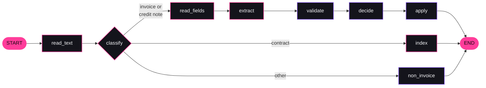

# IntakeFlow

A pipeline that turns supplier invoices and contracts (PDF) into validated structured data, sends uncertain cases to a person, and answers questions about a contract archive with citations. Built with Python, LangChain and LangGraph on Azure: Document Intelligence, Azure OpenAI, AI Search, Container Apps, Blob and Queue Storage, PostgreSQL and Key Vault.

It is a portfolio project, not a product. The company is fictional and every document is generated. There is no real customer data anywhere in it.

**The question the project works through:** how do you get reliable structured data out of messy documents with an LLM, know how reliable it is, and keep a person in charge of the uncertain cases, at a cost you can state per document?

## At a glance

| | |
| --- | --- |
| **What it is** | A document intake pipeline for accounts payable, built with LangChain and LangGraph on Azure, deployed to Azure Container Apps |
| **Extraction** | 97.3% and 96.2% of invoices fully correct (all eleven fields and every line item) on two sets of 186 |
| **Auto-approval** | About 70% of invoices approved without a person. Of those 135 and 127 documents, 3 and 0 were wrong. Every one of the 48 planted problems per set was caught |
| **Contract Q&A** | Right answer with the right clause and page for 199 of 199 answerable questions. Declined 38 of 41 questions that have no answer |
| **Cost** | About € 0.02 per invoice, computed from usage at list prices. Azure billed € 10.35 for the whole project in October, less than the computed amount |

All figures are for the configured variant, measured on generated documents that are easier than real ones. They are upper bounds. Details and caveats are under [Measured results](#measured-results).

## Contents

- [What it does](#what-it-does)
- [Screenshots](#screenshots)
- [What was built, deployed and measured](#what-was-built-deployed-and-measured)
- [Measured results](#measured-results)
- [Design rules](#design-rules)
- [LangChain and LangGraph in this project](#langchain-and-langgraph-in-this-project)
- [Azure in this project](#azure-in-this-project)
- [The synthetic data](#the-synthetic-data)
- [Testing](#testing)
- [Running it locally](#running-it-locally)
- [Deploying to Azure](#deploying-to-azure)
- [Limits](#limits)
- [What I would do next](#what-i-would-do-next)
- [Repository map](#repository-map)

## What it does

A fictional Dutch company, Noordzee Logistiek B.V., receives about 200 documents a week: supplier invoices, credit notes and a few contracts. IntakeFlow reads each one and decides what happens next.


Three roles use it through server-rendered pages (Jinja2 and HTMX, interface text in Dutch):

| Role | What they do |
| --- | --- |
| Finance clerk | Uploads documents, works through the review queue with the page next to the extracted fields, corrects, approves or rejects |
| Contract manager | Asks questions about the contract archive and gets the answer with contract, clause and page |
| Team lead | Sees a dashboard: share handled automatically, share corrected by a person, time to result, cost per document |

## Screenshots

The deployed application was removed on 21 October 2026 to stop its running cost, so these show what it looked like. They were taken on 12 October 2026 from the application running against the Azure services, with generated documents.

**Review queue.** Documents that need a person, each with the reason the checks gave.


**Reviewing a document.** The page next to the extracted fields. This invoice has a deliberately wrong IBAN: the check names it, and the reviewer can correct the field or approve anyway.


**A cited answer.** The answer comes with the contract, clause and page, looked up by code from the passage numbers the model gave.


**Dashboard.** Share approved automatically, time to result and cost per document, from the application's own records. The figures are for the ten documents in that environment, not a benchmark.


## What was built, deployed and measured

All seven stages of the plan in [docs/PRD.md](docs/PRD.md) are done. Each stage has a short note of what was decided, what was seen in practice and what is still open:

| Stage | Note |
| --- | --- |
| 1. Foundations and data | [cards/01-foundations-and-data.md](cards/01-foundations-and-data.md) |
| 2. Reading and extraction | [cards/02-reading-and-extraction.md](cards/02-reading-and-extraction.md) |
| 3. Validation and routing | [cards/03-validation-and-routing.md](cards/03-validation-and-routing.md) |
| 4. Review interface | [cards/04-review-interface.md](cards/04-review-interface.md) |
| 5. Contract Q&A | [cards/05-contract-qa.md](cards/05-contract-qa.md) |
| 6. Azure deployment | [cards/06-azure-deployment.md](cards/06-azure-deployment.md) |
| 7. Write-up | This README |

What ran where:

- **Run against real Azure services:** Document Intelligence, Azure OpenAI and Azure AI Search, on two sets of 200 synthetic documents each (October 2026). All accuracy, latency and cost figures below come from those runs.
- **Deployed to Azure, then removed:** the application itself ran on Container Apps in North Europe from 12 to 21 October 2026 and was used through the browser with ten synthetic documents. It was then removed with `./deploy/down-app.sh` to stop its running cost, so there is no live link. One command, `./deploy/up-app.sh`, recreates it.
- **Tested with fakes only:** everything in CI. The models, Document Intelligence and AI Search are replaced by fakes behind the same interfaces, so the tests need no Azure.
- **Deployed from GitHub Actions:** the deploy workflow, started by hand, built the image and updated both apps on 12 October 2026 (one successful run, after one that failed on sign-in).

## Measured results

Every number here was measured on synthetic documents, in one run per set, and is an upper bound for real documents. How each was measured is in the linked report.

### Extraction

186 invoices and credit notes per set. A field counts as right only when it equals the label exactly after normalising, and a document only when all eleven fields and all line items are right. Three ways of extracting were compared:

- **Document Intelligence only:** the fields its prebuilt invoice model returns.
- **Model only:** `gpt-4.1` reads the page text.
- **Combined:** `gpt-4.1` reads the page text with Document Intelligence's fields as a second opinion, and every field where the two disagree is flagged.

| Documents with every field right | First set (seed 42) | Second set (seed 43) |
| --- | --- | --- |
| Combined | 97.3% (181/186) | 96.2% (179/186) |
| Model only | 94.6% (176/186) | 93.5% (174/186) |
| Document Intelligence only | 98.4% (183/186) | 84.9% (158/186) |

Classification with `gpt-4.1-mini` was right for all 200 documents of both sets. Reports: [first set](reports/extraction-2026-10-12.md), [second set](reports/extraction-holdout-2026-10-12.md).

What the numbers say:

- **Document Intelligence alone was the best variant on the first set and the worst on the second.** Its errors cluster per supplier layout: on the second set it got the IBAN wrong on 14 documents, and those belong to two suppliers. Each supplier has one layout, so 186 documents from 25 suppliers behave like about 25 independent samples. The first set alone gave a misleading ranking, which is why the second set was made.
- **Its figures include one fix of ours.** On every invoice with two VAT rates (71 of 186 on the first set) it read both per-rate amounts correctly but returned only one of them, or nothing, as the VAT total. Summing its own per-rate amounts fixed all 71.
- **The model's weak spot is tables on skewed scans.** The read model returns a rotated table in an order that mixes rows, and the model then pairs quantities with the wrong prices.
- **A second opinion is not independent.** In an early run the model in the combined variant copied Document Intelligence's incomplete VAT total, although on its own it summed correctly. Because the two then agreed, nothing was flagged.

### Routing

A wrong auto-approval is an auto-approved document where any extracted field differs from the label, or where a labelled problem (a wrong IBAN, a duplicate, a wrong total) was missed.

| Auto-approved when validation alone decides | First set | Wrong | Second set | Wrong |
| --- | --- | --- | --- | --- |
| Combined | 72.6% (135/186) | 3 | 68.3% (127/186) | 0 |
| Model only | 72.0% (134/186) | 4 | 69.9% (130/186) | 1 |
| Document Intelligence only | 73.1% (136/186) | 1 | 66.1% (123/186) | 4 |

Reports: [first set](reports/routing-2026-10-12.md), [second set](reports/routing-holdout-2026-10-12.md).

- **Validation caught every labelled problem**, 48 of 48 on each set and in every variant. No document with a wrong IBAN, a duplicate, a wrong total or a purchase order problem was auto-approved.
- **The wrong auto-approvals are extraction errors that arithmetic cannot see**, such as line items in the wrong order or a supplier name cut short.
- **A confidence score did not help.** The first design required a score of 0.90, built mostly on Document Intelligence's confidence. It auto-approved 12% of the first set and sent 83% of the documents with nothing wrong to a person. Document Intelligence's median confidence for the invoice total was 0.66 on a field it got right 186 times out of 186.
- **How the setting was chosen.** "Validation alone, Document Intelligence only" was written down and committed before the second set was generated. Validation alone held up. The variant did not: it produced 4 wrong auto-approvals out of 123. The application now uses validation alone with the combined variant, kept because it is the only one where a second source can disagree, not because the data shows it to be better. Over both sets the three variants are too close to rank.

### Contract Q&A

120 labelled questions per set about 8 contracts, hybrid search without the semantic ranker. Reports: [first set](reports/qa-2026-10-12.md), [second set](reports/qa-holdout-2026-10-12.md).

| Measure | First set | Second set |
| --- | --- | --- |
| Right clause among the 5 passages offered | 100% (98/98) | 100% (101/101) |
| Right answer | 100% (98/98) | 100% (101/101) |
| Citation points to the labelled clause and page | 100% (98/98) | 100% (101/101) |
| Declined: this contract lacks the clause, others have it | 100% (14/14) | 100% (11/11) |
| Declined: no contract covers the subject | 75% (6/8) | 87.5% (7/8) |

- **These numbers say little about real contracts.** All 16 contracts come from the same nine clause templates, and each fact sits in one sentence. They show that the pipeline is wired correctly and that citing and declining work on easy material.
- **All three failures are one question**, about an insured amount. The liability clause mentions insurance without an amount, and in two cases the model gave the liability cap as the insured amount: a wrong answer with a correct-looking citation.
- **Paraphrased and English questions found the Dutch clauses**, including questions that avoid the contract's own key word.
- **The semantic ranker did slightly worse** (97 of 98 and 98 of 101 right), so it is switched off.

### Latency and cost

| Step | Median | 95th percentile | Cost |
| --- | --- | --- | --- |
| Read text (`prebuilt-read`) | 2.3 s | 19.2 s | € 1.32 per 1,000 pages |
| Classify (`gpt-4.1-mini`) | 0.6 s | 1.1 s | about € 0.0003 per document |
| Read invoice fields (`prebuilt-invoice`) | 7.3 s | 7.6 s | € 8.80 per 1,000 pages |
| Extract (`gpt-4.1`) | 3.6 s | 10.8 s | about € 0.01 per invoice |
| Answer a contract question (`gpt-4.1`) | 0.8 s | 3.8 s | about € 0.0025 per question |

| Cost per invoice, all steps | Per invoice | Per 1,000 |
| --- | --- | --- |
| Combined | € 0.0206 | € 20.61 |
| Model only | € 0.0100 | € 9.96 |
| Document Intelligence only | € 0.0105 | € 10.46 |

- Latency was measured per call from a laptop on the first set, so network time is included.
- Cost is computed from page and token counts at list prices from Azure's retail price API on 11 October 2026 (Sweden Central, EUR).
- **The bill came in lower than these figures.** Azure billed € 9.15 for Azure OpenAI and Document Intelligence in October, against about € 13 computed from the usage records. The cause was not investigated, so these per-invoice costs are probably on the high side. See [Cost, as billed by Azure](#cost-as-billed-by-azure).

### In Azure

Ten synthetic documents uploaded through the browser of the deployed application:

| Measure | Value |
| --- | --- |
| Outcome | Six invoices auto-approved (five digital, one scanned), one contract indexed, three sent to review for the expected reasons |
| Time from upload to result, median | 88 seconds |
| Cost per document | € 0.0193 |

The 88 seconds are mostly waiting: seven documents were uploaded at once, one worker handles one at a time, and it started from zero. The steps of one document add up to about 14 seconds. Processing and waiting were not measured separately in Azure. Ten documents show that the deployment works. They are not a performance measurement.

## Design rules

Eight rules hold throughout, and most are enforced by a test or by the database, not by convention.

| Rule | How it is enforced |
| --- | --- |
| **One door to a model.** Model, embedding and Document Intelligence clients are imported only in `app/inference/` and `app/reading/`, the search client only in `app/rag/` | A test parses every source file and fails on such an import anywhere else. It is also run against a tree that breaks the rule on purpose |
| **Steps are stateless and idempotent.** A step reads from the database, writes to the database, and is skipped when its audit record exists | Tests run every document twice and count calls. Each step's output, usage record and audit record are committed together |
| **The model never approves alone.** Auto-approval needs every check to pass and no field to be flagged | One function decides. A test fails if any other file sets the auto-approved status, and tests give a failing invoice a perfect score |
| **One path to the mock ERP.** Only approved or auto-approved documents are booked, through one function | A source-reading test, plus a database trigger that refuses any other insert |
| **Human edits never overwrite model output.** Corrections are stored in their own record | A test corrects an IBAN and checks that the stored extraction still holds the wrong one |
| **Citations are resolved by code.** The model answers with passage numbers, the code looks up contract, clause and page | Numbers that were not offered are dropped and reported. An answer without a valid source is replaced by "Niet gevonden in de documenten" |
| **The audit log is append-only and hash-chained.** | No update or delete function exists, a trigger refuses both, and a chain check detects tampering even with the trigger switched off |
| **No document content in logs or metric labels.** | Audit payloads hold ids, names of checks and counts. Errors are stored by kind, never by message. A test searches the log for document values |

## LangChain and LangGraph in this project

The frameworks are used where they do real work and kept behind the project's own interfaces everywhere. Pinned versions: `langchain-core` 1.6.9, `langchain-openai` 1.7.0, `langgraph` 1.2.14, `langgraph-checkpoint-postgres` 3.1.2.

### Where each piece is used

| LangChain or LangGraph feature | Where | What it does here |
| --- | --- | --- |
| `AzureChatOpenAI` | [app/inference/azure_openai.py](app/inference/azure_openai.py) | The chat model, with keyless sign-in through a token provider, temperature 0 and five retries with backoff |
| `with_structured_output(..., method="json_schema", strict=True, include_raw=True)` | same file | Turns a Pydantic schema into a strict JSON-schema request and parses the answer back. `include_raw` keeps the raw message, which carries the token counts |
| `AzureOpenAIEmbeddings` | same file | Embeds contract clauses and questions with `text-embedding-3-large`, shortened to 1,024 dimensions |
| `BaseRetriever` | [app/rag/retriever.py](app/rag/retriever.py) | `ContractRetriever` adapts the project's search to LangChain's retriever interface |
| `StateGraph`, nodes, conditional edges | [app/workflow/graph.py](app/workflow/graph.py) | The document workflow: nine nodes, one three-way branch after classification |
| `RetryPolicy` | same file | Three attempts with backoff on the five nodes that call Azure |
| `AsyncPostgresSaver` (checkpointer) | [app/main.py](app/main.py), [app/worker.py](app/worker.py) | Saves the workflow's state in PostgreSQL after every node, one thread per document |
| `InMemorySaver` | tests | The same graph in tests, without a database for checkpoints |

### Structured output

The extraction step asks the model for an invoice as data, not as text.

- **Two schemas on purpose.** `LlmInvoice` in [app/agents/schema.py](app/agents/schema.py) is what the model fills in: flat, text-only, and every property required, because that is what strict mode accepts. `ExtractedInvoice` is what the application stores: canonical values, the page, the printed text, Document Intelligence's value and confidence, and flags.
- **Strict mode shapes the schema.** Optional fields are written as required-but-nullable. Numeric ranges are not expressed in the schema. The classifier's confidence, for example, is clamped by code.
- **The model normalises, the code checks.** Each field comes back both normalised and as printed. The project's own parsers for Dutch (`1.234,56`, `15-10-2026`) and English (`1,234.56`) formats re-read the printed form, and a difference is flagged. A test covers the classic error of reading `1.234,56` as `1.23`.
- **Answers that do not fit the schema are an error**, raised without the answer's text, because it may quote the document.
- **Prompts are versioned files** in [prompts/](prompts/), not strings in code and not LangChain prompt templates. The file name is the version and is part of each stored result's key, so a new prompt is a new run next to the old one. This is how extraction prompt version 2 was compared with version 1.

### The workflow as a graph



Nodes with a pink border call Azure and have a retry policy. Nodes with a violet border are plain code.

- **State** is a small typed dictionary: the document's id, its label and the decision. The documents themselves live in the database, not in the graph's state.
- **Each node** opens its own database session, calls one step function and commits, so a step's output and its audit record are stored before the graph moves on.
- **Retries** are declared per node. A throttled call is retried inside the run. A test makes the reader fail twice and checks that the third attempt completes the document.
- **Resume.** After a failure the checkpoint records which node is next. Calling the graph again with no input for the same thread continues from there. A test stops a run at the invoice-fields node, builds a new graph object as after a restart, and checks that the text is not read a second time.
- **Dead letters.** Around the graph, a failed run is counted on the document, and after three it is parked with status `failed`.

### What LangChain is deliberately not used for

| Not used | Used instead | Why |
| --- | --- | --- |
| The ready-made Azure AI Search vector store | The Azure SDK behind a two-method `SearchIndex` interface | The integration is a large package for about fifty lines, and it hides the clause number and page that citations need |
| Document loaders | Azure Document Intelligence behind `DocumentReader` | Scanned pages need OCR and the invoice model returns fields with confidence, which a loader does not give |
| Agents and tools | A fixed graph | The steps and their order are known. Nothing here needs a model to choose the next action |
| Chains (LCEL) | Plain async functions | Each step is one model call with code before and after it |
| LangSmith | OpenTelemetry to Application Insights | One place for traces and logs, and no document content leaves for a third service |

### What using the frameworks taught

- **Structured output replaces a lot of code.** Asking for JSON in a prompt, parsing it and retrying on bad output becomes one call. The price is knowing which JSON-schema features strict mode accepts.
- **The embeddings interface returns vectors only.** Token counts for embeddings are therefore estimated in this project, while chat calls report real counts.
- **The checkpoint adds less than expected when steps are already idempotent.** Starting a failed document over would also continue where it stopped, because finished steps are skipped. What the checkpoint adds is a record of which node a run stopped at.
- **The Postgres checkpointer brings its own driver and tables.** It uses `psycopg` while the application uses `asyncpg`, so the project has two PostgreSQL drivers, and the two spell the TLS option differently. Its tables are created by the library outside the Alembic migrations, and the migration check had to be told to ignore them.
- **Type hints are loose in places.** Under `mypy --strict` the graph builder had to be left untyped, because the overloads of `add_node` do not accept a plain async function.
- **Retries inside the library do not remove the need for your own.** With six documents in parallel, five failed on rate limits after LangChain's retries ran out. Idempotent steps made a second run pick up only those.
- **Keeping the framework behind interfaces paid off in tests.** `ChatModel`, `EmbeddingModel`, `DocumentReader` and `SearchIndex` are plain Python protocols. The fakes implement them directly, so the whole pipeline, including the graph, runs in CI in about half a minute without any network.

## Azure in this project

Everything runs in one Azure subscription (pay-as-you-go) and one resource group, `rg-intakeflow-dev`. Every resource below is created by the Bicep files in [deploy/](deploy/). The facts in this section were read from the live resources with the Azure CLI on 21 October 2026.

**Current state (21 October 2026):** the application layer (everything from `ca-intakeflow-web` down in the table below) has been removed to stop its running cost. The AI layer (Azure OpenAI, Document Intelligence, AI Search and the budget) is still there. It costs nothing while it is not used, and it lets the application run from a laptop. `./deploy/up-app.sh` recreates the application layer in about fifteen minutes.

### Regions, and why two

| Region | What runs there | Why |
| --- | --- | --- |
| Sweden Central | Azure OpenAI, Document Intelligence | The planned region. Model quota was available there for the regional deployment type |
| North Europe | Everything else: Container Apps, PostgreSQL, Storage, Key Vault, Container Registry, AI Search, monitoring | Sweden Central had no capacity for a new search service or a new PostgreSQL server, and West Europe did not accept new search customers. The application sits in the same region as its database, because it makes many small database calls per document and few model calls |

### Every resource

| Resource name | Azure service | Tier | Region | Used for | Defined in |
| --- | --- | --- | --- | --- | --- |
| `oai-intakeflow-…` | Azure OpenAI | S0 | Sweden Central | Classification, extraction, contract answers, embeddings | [ai.bicep](deploy/ai.bicep) |
| `di-intakeflow-…` | Azure AI Document Intelligence | S0 | Sweden Central | Reading PDFs and invoice fields | [ai.bicep](deploy/ai.bicep) |
| `srch-intakeflow-…` | Azure AI Search | Free | North Europe | Hybrid search over contract clauses | [ai.bicep](deploy/ai.bicep) |
| `budget-intakeflow-dev` | Cost Management budget | none | none | € 35 a month, alerts at 50%, 80% and 100% | [budget.bicep](deploy/budget.bicep) |
| `ca-intakeflow-web` | Azure Container Apps (app) | Consumption | North Europe | The web application | [app.bicep](deploy/app.bicep) |
| `ca-intakeflow-worker` | Azure Container Apps (app) | Consumption | North Europe | The queue worker that runs the workflow | [app.bicep](deploy/app.bicep) |
| `cae-intakeflow-…` | Container Apps environment | Consumption profile | North Europe | Shared environment for both apps | [app.bicep](deploy/app.bicep) |
| `psql-intakeflow-…` | Azure Database for PostgreSQL Flexible Server | Burstable B1ms, PostgreSQL 17, 32 GB | North Europe | All application data and the workflow checkpoints | [app.bicep](deploy/app.bicep) |
| `stintake…` | Azure Storage account | Standard LRS, StorageV2 | North Europe | Blob container `documents` (uploaded PDFs) and queue `documents` (work items) | [app.bicep](deploy/app.bicep) |
| `kv-intake-…` | Azure Key Vault | Standard | North Europe | The secret `database-url` | [app.bicep](deploy/app.bicep) |
| `crintakeflow…` | Azure Container Registry | Basic | North Europe | The image `intakeflow`, tagged with the git commit | [app.bicep](deploy/app.bicep) |
| `id-intakeflow-…` | User-assigned managed identity | none | North Europe | How both apps sign in to every other service | [app.bicep](deploy/app.bicep) |
| `log-intakeflow-…` | Log Analytics workspace | Pay-as-you-go (PerGB2018), 30 days retention | North Europe | Container logs and telemetry storage | [app.bicep](deploy/app.bicep) |
| `appi-intakeflow-…` | Application Insights | Workspace-based | North Europe | Traces, requests and logs through OpenTelemetry | [app.bicep](deploy/app.bicep) |
| Application Insights Smart Detection | Action group | none | Global | Created by Azure automatically together with Application Insights. Not used by the project | none |

The `…` stands for a suffix that Bicep derives from the resource group and region, so names are unique and stable between deployments.

### Azure OpenAI

| Deployment | Model and version | Deployment type | Capacity | Used for | Code |
| --- | --- | --- | --- | --- | --- |
| `gpt-4.1-mini` | gpt-4.1-mini, 2025-04-14 | Standard (regional) | 50,000 tokens a minute | Classifying every document | [app/agents/classify.py](app/agents/classify.py) |
| `gpt-4.1` | gpt-4.1, 2025-04-14 | Standard (regional) | 50,000 tokens a minute | Extracting invoice fields, answering contract questions | [app/agents/extract.py](app/agents/extract.py), [app/rag/answer.py](app/rag/answer.py) |
| `text-embedding-3-large` | text-embedding-3-large, version 1 | Standard (regional) | 50,000 tokens a minute | Embedding contract clauses and questions, shortened to 1,024 dimensions | [app/workflow/routing_steps.py](app/workflow/routing_steps.py), [app/rag/answer.py](app/rag/answer.py) |

- **How the app calls it:** through LangChain's `AzureChatOpenAI` and `AzureOpenAIEmbeddings` (`langchain-openai` 1.7.0), wrapped in [app/inference/azure_openai.py](app/inference/azure_openai.py). REST API version `2024-10-21`.
- **Request settings:** temperature 0, structured output in strict JSON-schema mode, five retries with backoff, 120-second timeout.
- **Deployment type:** regional Standard, so prompts are processed in Sweden Central. The plan was the EU data-zone type, but the subscription had zero quota for it for these models.
- **Sign-in:** Microsoft Entra ID tokens, no API keys. Local (key) authentication is switched off on the resource.
- **Settings:** `AZURE_OPENAI_ENDPOINT`, `AZURE_OPENAI_API_VERSION`, and one setting per deployment name (`AZURE_OPENAI_CLASSIFY_DEPLOYMENT`, `AZURE_OPENAI_EXTRACT_DEPLOYMENT`, `AZURE_OPENAI_ANSWER_DEPLOYMENT`, `AZURE_OPENAI_EMBEDDING_DEPLOYMENT`).
- **What was seen:** classification was right for 400 of 400 documents. Rate limits are the practical limit: with six documents processed in parallel during evaluation, five failed after their retries ran out.

### Azure AI Document Intelligence

| Model | When it runs | Price at list (Sweden Central) |
| --- | --- | --- |
| `prebuilt-read` | Every document, first, because a scan has no text until it is read | € 1.32 per 1,000 pages |
| `prebuilt-invoice` | Only invoices and credit notes, after classification | € 8.80 per 1,000 pages |

- **How the app calls it:** the `azure-ai-documentintelligence` 1.0.2 SDK (REST API version `2024-11-30`), wrapped in [app/reading/azure_di.py](app/reading/azure_di.py). The SDK retries throttled calls itself.
- **What is kept:** the text per page, every field with its confidence and page, and the raw result without the per-word boxes, for debugging and comparison.
- **Tier S0, not Free:** the free tier reads only the first two pages of a file, which would cut off a three-page contract.
- **Read, not Layout, for the first pass:** Layout costs as much as the invoice model, and classification only needs text.
- **Sign-in:** Entra ID tokens. Local authentication is off.
- **Setting:** `AZURE_DOCUMENT_INTELLIGENCE_ENDPOINT`.
- **What was seen:** strong on layout, including skewed scans. Its VAT total was incomplete on all 71 two-rate invoices of the first set, its errors repeat for every document of a supplier, and its confidence did not track correctness. See [Measured results](#measured-results).

### Azure AI Search

- **Tier:** Free, one replica, one partition. Every feature the project needs worked on it: hybrid search, keyless access and the semantic ranker's free allowance.
- **Indexes:** three, which is the free tier's limit: `contracts` for the application, and `contracts-eval` and `contracts-holdout` for the two evaluation sets.
- **Index definition** ([app/rag/azure_search.py](app/rag/azure_search.py)): fields `id`, `document_id`, `title`, `clause_number`, `heading`, `page`, `text` and `vector`. The text fields use the Dutch analyser `nl.microsoft`. The vector field has 1,024 dimensions with an HNSW profile. A semantic configuration ranks on title, text and heading.
- **Query:** one request per question with the question as text (keyword search) and as a vector (vector search). The service merges the two rankings. The semantic ranker is a switch (`SEARCH_SEMANTIC_RANKER`), measured both ways and left off.
- **How the app calls it:** the `azure-search-documents` 12.0.0 SDK, only inside `app/rag/` (a test enforces this).
- **Sign-in:** Entra ID tokens. Local authentication (admin and query keys) is off.
- **Settings:** `AZURE_SEARCH_ENDPOINT`, `AZURE_SEARCH_INDEX`, `SEARCH_TOP_K`, `SEARCH_SEMANTIC_RANKER`.

### Azure Container Apps

| | Web application | Worker |
| --- | --- | --- |
| App | `ca-intakeflow-web` | `ca-intakeflow-worker` |
| Command | `alembic upgrade head`, then `uvicorn app.main:app` on port 8000 | `python -m app.worker` |
| Resources per replica | 0.5 vCPU, 1 GiB | 0.5 vCPU, 1 GiB |
| Replicas | 0 to 1 | 0 to 1 |
| Scales on | HTTP requests | Queue length: a KEDA `azure-queue` rule on the queue `documents`, one replica per waiting message, signing in with the managed identity |
| Ingress | External, HTTPS only | None |
| Health | Readiness probe on `/health` | none |
| Access | Microsoft sign-in (Container Apps built-in authentication), limited to one account. `/health` is the only open path | Not reachable from outside |

- **Image:** one image for both, built from the [Dockerfile](Dockerfile) on `python:3.12-slim`, running as a non-root user. It is built inside the registry with `az acr build` and tagged with the git commit. The apps pull it with the managed identity, and the registry's admin account is off.
- **The queue:** an upload puts the document's id on the queue `documents`. The worker takes one message at a time and hides it for 600 seconds while it works. It deletes the message when the document has a result. A message that is not deleted reappears, so a worker that dies mid-document does not lose it. After three failed runs the document is parked with status `failed` and the message is deleted.
- **Settings passed to both apps** (from [app.bicep](deploy/app.bicep)):

| Setting | Value |
| --- | --- |
| `DATABASE_URL` | Container Apps secret, read from Key Vault with the managed identity |
| `AZURE_CLIENT_ID` | The managed identity, so the Azure SDKs know which identity to use |
| `AZURE_DOCUMENT_INTELLIGENCE_ENDPOINT`, `AZURE_OPENAI_ENDPOINT`, `AZURE_SEARCH_ENDPOINT` | The three AI services |
| `STORAGE_BACKEND`, `AZURE_STORAGE_BLOB_URL`, `BLOB_CONTAINER` | `blob`, the storage account's blob endpoint, `documents` |
| `DISPATCH_BACKEND`, `AZURE_STORAGE_QUEUE_URL`, `QUEUE_NAME` | `queue`, the storage account's queue endpoint, `documents` |
| `APPLICATIONINSIGHTS_CONNECTION_STRING` | Switches telemetry on |
| `SEED_PURCHASE_ORDERS_FILE` | The synthetic purchase orders, loaded when the web application starts |

### Azure Database for PostgreSQL

- **Server:** Flexible Server, Burstable B1ms, PostgreSQL 17, 32 GB storage, 7 days of backups, no high availability.
- **Holds:** documents, readings, classifications, extractions, validations, routing decisions, reviews, the mock ERP table, the hash-chained audit log, usage records, contract passages, and LangGraph's checkpoint tables.
- **Drivers:** the application uses `asyncpg` and LangGraph's checkpointer uses `psycopg`. TLS is required (`ssl=require` and `sslmode=require` respectively).
- **Migrations:** Alembic, applied by the web application when it starts.
- **Access:** an administrator login with a 48-character random password. The deploy script generates a new one on every deploy and writes it straight into Key Vault inside the database URL. It is never printed or stored on disk.
- **Network:** public endpoint with one firewall rule, "allow Azure services". That admits connections from any Azure service, not only this application. The password and TLS are what protect it. This is a known gap, see [Limits](#limits).

### Azure Storage

- **Account:** Standard LRS, StorageV2, TLS 1.2 minimum, HTTPS only, public blob access off, and shared key (account key) access off. Only Entra ID tokens work.
- **Blob container `documents`:** the uploaded PDFs, one blob per document, named by document id.
- **Queue `documents`:** document ids waiting for the worker.
- **How the app calls it:** `azure-storage-blob` 12.31.0 ([app/storage/blob.py](app/storage/blob.py)) and `azure-storage-queue` 12.18.0 ([app/workflow/queue.py](app/workflow/queue.py)).

### Identity, roles and secrets

The application has one user-assigned managed identity. Each role is assigned on one resource only:

| Role | On | So that |
| --- | --- | --- |
| AcrPull | Container Registry | Both apps can pull the image |
| Storage Blob Data Contributor | Storage account | Uploads are stored and read back |
| Storage Queue Data Contributor | Storage account | The web application enqueues, the worker dequeues, and the KEDA rule reads the queue length |
| Key Vault Secrets User | Key Vault | The apps can read `database-url` |
| Cognitive Services User | Document Intelligence | Documents can be read |
| Cognitive Services OpenAI User | Azure OpenAI | Models can be called |
| Search Index Data Contributor | AI Search | Passages can be written and searched |
| Search Service Contributor | AI Search | The index can be created |

Two more identities have access:

- **The developer's own account** (`az login`) has the same AI and search roles plus Blob Data Contributor, so the code runs from a laptop without keys.
- **The GitHub deploy workflow** signs in with OpenID Connect through an Entra app registration with a federated credential, and has Contributor on this resource group only. Azure matches the identity GitHub presents character for character, and that includes the numeric ids of the owner and the repository (`repo:owner@id/name@id:ref:refs/heads/main`).

**Secrets.** There is one: the database URL, in Key Vault (RBAC mode, 7 days soft delete). No API key, account key or connection string with a key exists anywhere. Key access is off on Azure OpenAI, Document Intelligence, AI Search and Storage. `.env` is git-ignored and holds only endpoints.

**Sign-in to the web application.** An Entra app registration (`intakeflow-web-signin`) with ID-token sign-in and no client secret. The Container Apps authentication setting allows only the deploying account's object id.

### Monitoring

- **OpenTelemetry to Application Insights** through `azure-monitor-opentelemetry` 1.8.11, switched on by `APPLICATIONINSIGHTS_CONNECTION_STRING` and off everywhere else ([app/observability/telemetry.py](app/observability/telemetry.py)). Requests, traces and the application's log lines are exported with the service names `intakeflow-web` and `intakeflow-worker`.
- **Container logs** go to the Log Analytics workspace, with 30 days of retention.
- **No document content** is logged. The Azure and HTTP libraries logged every request with all headers at their default level, and are set to warnings only.
- **Cost and latency per document** come from usage records in the database, not from telemetry.
- **No alerts** except the budget.

### Infrastructure as code and deployment

| File | Scope | Creates |
| --- | --- | --- |
| [deploy/main.bicep](deploy/main.bicep) | Subscription | The resource group, and calls the three modules below |
| [deploy/budget.bicep](deploy/budget.bicep) | Resource group | The budget, before anything that can cost money |
| [deploy/ai.bicep](deploy/ai.bicep) | Resource group | Azure OpenAI with three deployments, Document Intelligence, AI Search, and the developer's roles |
| [deploy/app.bicep](deploy/app.bicep) | Resource group | Everything tagged `part=app`: Container Apps, PostgreSQL, Storage, Key Vault, registry, identity, monitoring and all application roles |

| Command | Does |
| --- | --- |
| `./deploy/up.sh` | Registers the resource providers, deploys the AI layer, prints the endpoints for `.env` |
| `./deploy/up-app.sh` | Deploys the application in three steps: resources, then `az acr build`, then the two apps with sign-in |
| `--what-if` on either | Shows what would change without changing anything |
| `./deploy/down-app.sh` | Deletes everything tagged `part=app` and purges the Key Vault. The AI layer stays |
| `./deploy/down.sh` | Deletes the resource group and purges the AI accounts |
| GitHub Actions "Deploy" | Started by hand: builds a new image in the registry and updates both apps, then checks `/health` |

A dry run checks the templates. It does not check quota or region capacity, which is where both failed deployments of this project went wrong.

### Cost, as billed by Azure

From Azure Cost Management for October 2026, read on 21 October (billing data runs about a day behind):

| Service on the bill | Billed |
| --- | --- |
| Azure OpenAI ("Foundry Models") | € 7.71 |
| Document Intelligence ("Foundry Tools") | € 1.44 |
| Container Registry | € 1.20 |
| Storage | € 0.01 |
| PostgreSQL, AI Search, Key Vault, Log Analytics | € 0.00 |
| Container Apps | not on the bill |
| **Total** | **€ 10.35** |

- **Almost all of it is one day.** 12 October, when the evaluation runs happened, accounts for € 9.22. From 13 to 21 October the bill grew by about € 0.15 a day, which was the container registry. With the application layer removed on 21 October, nothing in the resource group costs money unless it is used.
- **The database and Container Apps have cost nothing so far.** That is likely Azure's free allowances for this database tier and the Container Apps monthly free grant, but this was not verified. Without them, the database alone would be about € 0.42 a day at list price.
- **The bill is lower than the project's own cost counts.** For Azure OpenAI and Document Intelligence together the usage records add up to about € 13 at the list prices of 11 October, against € 9.15 billed. Document Intelligence shows the largest gap. The cause has not been investigated, so the per-invoice costs in this README are the computed ones, and are probably on the high side.

### What Azure taught

- **Capacity and quota decide the region, and a dry run sees neither.** Sweden Central had no quota for the planned model deployment type, no capacity for a search service and no capacity for a database. West Europe did not accept new customers for search.
- **Keep application and database in the same region**, and let the few, slow model calls cross regions.
- **Free and consumption tiers go a long way for a demo.** While the application was idle, only the registry cost money. With the application removed, an unused project costs nothing.
- **Billing data lags, and the computed cost was higher than the bill.** Measure from usage, then check against the invoice.
- **Teardown has to be tested like everything else.** The script that removes the application had a bug that only showed on a half-finished deployment.

## The synthetic data

`scripts/generate_synthetic.py` writes PDFs and a ground-truth file per document from a fixed seed. The labels and the questions are committed. The PDFs are rebuilt from the seed, and a test regenerates the labels and compares them with the committed files, so a label cannot be edited by hand.

| | First set (seed 42) | Second set (seed 43) |
| --- | --- | --- |
| Invoices | 165 | 166 |
| Credit notes | 21 | 20 |
| Contracts | 8 | 8 |
| Other mail (reminders, delivery notes, order confirmations) | 6 | 6 |
| Labelled questions about the contracts | 120 | 120 |

Hard cases are included on purpose, each labelled with the check that should catch it:

| Hard case | Per set | Should cause |
| --- | --- | --- |
| Scanned page, no text layer | 14 | nothing |
| Scanned and skewed | 9 | nothing |
| Stamp over the totals | 9 | nothing |
| Missing purchase order number | 9 | `po_missing` |
| Total does not add up | 7 | `totals_mismatch` |
| Duplicate invoice | 6 | `duplicate_invoice` |
| Wrong IBAN | 5 | `iban_checksum` |
| Purchase order amount differs | 5 | `po_amount_out_of_tolerance` |
| Unknown purchase order | 4 | `po_not_found` |
| Purchase order of another supplier | 4 | `po_supplier_mismatch` |
| Malformed VAT number | 4 | `vat_number_format` |
| Due date before invoice date | 4 | `due_date_before_invoice_date` |

Invoices come in four layouts, in Dutch and English, with Dutch and English number and date formats. Contracts leave out some clauses on purpose, so that a question about a missing clause has to be declined.

## Testing

- **256 unit and integration tests and one browser test**, about 84% line coverage, all in CI on every push together with `ruff` and `mypy --strict`.
- **No Azure in CI.** Fakes implement the same interfaces as the real services. The integration tests use a real PostgreSQL.
- **Tests build the system wrongly on purpose**, to show that a guarantee can fail: a model client imported in the wrong module, a second path to the ERP, a perfect score on an invoice with a wrong IBAN, a model that cites passage 7 of 3, a model that misreads every total.
- **Evaluation is a script, not a test.** `scripts/evaluate_extraction.py`, `evaluate_routing.py` and `evaluate_qa.py` write the reports in [reports/](reports/). Each can also run with fakes that answer from the ground truth, which checks the evaluation code itself.
- **Real-service tests** are marked `azure` and run only on request.
- **The browser test** starts the application with fakes on its own database and goes through upload, the queue, a review with a correction, approval and the dashboard.

## Running it locally

Needs Python 3.12, [uv](https://docs.astral.sh/uv/) and Docker.

```bash
cp .env.example .env                      # then choose a local database password
uv sync
docker compose up -d                      # local PostgreSQL
uv run alembic upgrade head
uv run python scripts/generate_synthetic.py --documents 200 --seed 42
uv run python scripts/load_purchase_orders.py
uv run uvicorn app.main:app --reload      # http://localhost:8000, pick a role

uv run pytest tests/unit tests/integration
uv run playwright install chromium        # once
uv run pytest tests/e2e                   # browser tests
uv run ruff check . && uv run mypy .

uv run python scripts/evaluate_extraction.py --services oracle --limit 20   # evaluation code with fakes
uv run python scripts/evaluate_routing.py --services oracle --limit 20
uv run python scripts/evaluate_qa.py --services oracle
```

Without Azure endpoints in `.env` the application starts, and uploads are stored but not processed. The integration tests use a separate database (`<name>_test`) that is rebuilt on every run.

## Deploying to Azure

Needs an Azure subscription and the Azure CLI, signed in with `az login`.

```bash
./deploy/up.sh --what-if                  # preview the AI resources, changes nothing
./deploy/up.sh                            # budget alert, Document Intelligence, Azure OpenAI, AI Search
uv run pytest tests/azure -m azure        # smoke test against the real services
uv run python scripts/evaluate_extraction.py --services azure --limit 10

./deploy/up-app.sh --what-if              # preview the application
./deploy/up-app.sh                        # Container Apps, Postgres, storage, Key Vault, registry, monitoring
./deploy/down-app.sh                      # remove the application, keep the AI resources
./deploy/down.sh                          # delete everything
```

After `./deploy/up.sh`, put the three endpoints it prints in `.env`. The full extraction evaluation of one set of 200 documents cost about € 5.40 at list prices, and a question-answering run of 240 questions about € 0.60.

### Runbook

| Situation | What to do |
| --- | --- |
| Is it up? | `curl https://<web address>/health` returns `{"status":"ok"}`. The first request after a quiet period takes longer, because the application starts from zero |
| A document stays "in verwerking" | The worker starts when a message is on the queue. Look at its log: `az containerapp logs show -g rg-intakeflow-dev -n ca-intakeflow-worker --tail 50` |
| A document is "Mislukt" | It failed three times. Its audit records hold the kind of error. There is no retry button |
| Deploy a new version | Start the "Deploy" workflow in GitHub Actions, or run `./deploy/up-app.sh` |
| A region has no capacity | Change `appLocation` or `searchLocation` in `deploy/main.bicep` |
| Stop the daily cost | `./deploy/down-app.sh`. Deleting the Container Apps environment takes about twenty minutes |
| Cost so far | Azure portal, Cost Management, resource group `rg-intakeflow-dev`. The budget alert mails at 50%, 80% and 100% of € 35 a month |
| Who can open the application | One Microsoft account, set at deploy time |

## Limits

- **A demo, not a product.** Fictional company, generated documents, one user.
- **Synthetic documents are easier than real ones.** The scans are clean renders that were rasterised, blurred and rotated. There is no noise, handwriting or folding. The contracts share nine clause templates. Every accuracy figure is an upper bound.
- **Small samples.** Two sets of 186 invoices from about 50 suppliers, one run each. Differences of a few documents between variants mean nothing.
- **Results depend on the models** and may change when they are updated or retired.
- **Per-document costs are computed, and the bill was lower.** Why the two differ was not investigated.
- **Line items cannot be corrected** in the review interface, only the eleven fields, and disagreement on line items between the two sources is not flagged.
- **Contract answers have two outcomes**, found or not found. "The contract mentions this but gives no figure" is not one of them, which is where the Q&A failures come from.
- **Keeping an answer within the right contract rests on the prompt**, not on a filter in the search.
- **Security is demo-grade.** No real sign-in inside the application, no CSRF protection, and the deployed database accepts connections from any Azure service, protected by its password and TLS.
- **One worker, one document at a time.** Time to result in Azure is dominated by waiting.
- **Not done:** there is no alerting beyond the budget, nobody has built a view on the telemetry, and the interface has been used by one person.

## What I would do next

In this order:

1. **Flag line items where the two sources disagree.** Every wrong auto-approval measured here is an extraction error that arithmetic cannot see, mostly in line items, and line items are the one place where the model's answer is not compared with Document Intelligence's.
2. **Close the two security gaps** before anything beyond a demo: CSRF protection on the forms, and a private network for the database instead of "any Azure service".
3. **Give contract answers a third outcome**, "the contract mentions this but gives no figure", and filter the search to the contract the question names. The Q&A failures come from the lack of these.
4. **Test on harder documents.** More layouts per set, scans with noise and folds, and contracts that are not written from the same templates.
5. **Run more than one worker**, measure processing time and waiting time separately, and find out why the computed cost is higher than the bill.

## Repository map

| Path | What is in it |
| --- | --- |
| `app/inference/` | Model and embedding interfaces, the Azure OpenAI implementation through LangChain, fakes |
| `app/reading/` | Document reader interface, the Document Intelligence implementation, a fake |
| `app/rag/` | Clause chunking, search interface with Azure AI Search and in-memory implementations, answering with citations, the LangChain retriever |
| `app/agents/` | Classification, extraction, schemas, normalisation of numbers and dates, prompt loading |
| `app/validation/` | The checks, scoring and the routing decision |
| `app/workflow/` | The pipeline steps, the LangGraph graph, ingestion, the queue |
| `app/review/` | Approve, correct and reject |
| `app/erp/` | The single function that books into the mock ERP |
| `app/audit/` | The hash-chained audit log |
| `app/web/` | Pages, templates, upload endpoint |
| `app/observability/` | Telemetry, the dashboard's figures, the price table |
| `app/storage/` | Local folder and Blob Storage behind one interface |
| `app/worker.py` | The queue worker |
| `prompts/` | Versioned prompt files |
| `scripts/` | The synthetic data generator and the three evaluation scripts |
| `deploy/` | Bicep and the deploy and teardown scripts |
| `tests/` | Unit, integration, browser and on-request Azure tests |
| `cards/` | One note per stage |
| `reports/` | Evaluation reports |
| `docs/PRD.md` | The plan this was built from |
