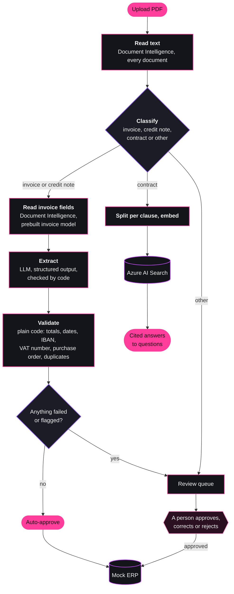
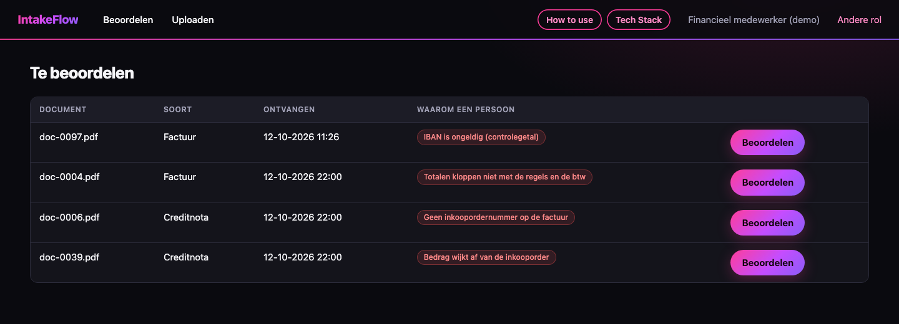
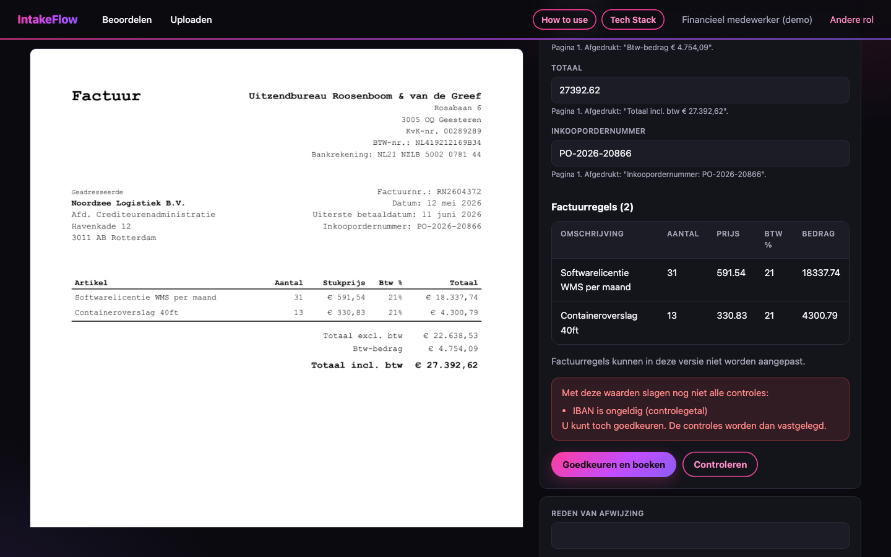
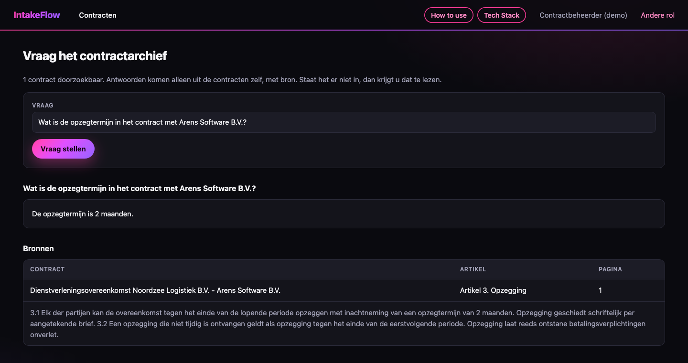
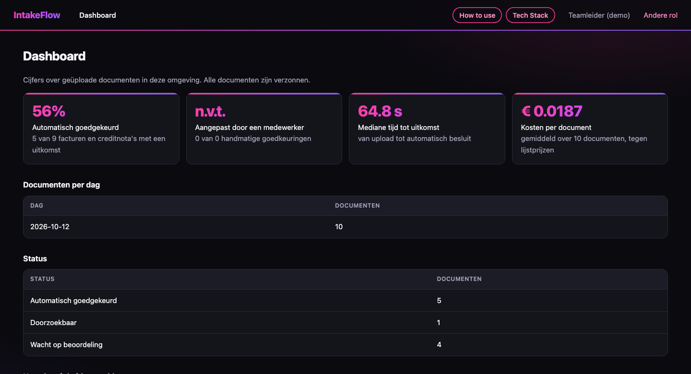

# IntakeFlow

A pipeline that turns supplier invoices and contracts (PDF) into validated structured data, sends uncertain cases to a person, and answers questions about a contract archive with citations. Built with Python, LangChain and LangGraph on Azure: Document Intelligence, Azure OpenAI, AI Search, Container Apps, Blob and Queue Storage, PostgreSQL and Key Vault.

It is a portfolio project, not a product. The company is fictional and every document is generated. There is no real customer data anywhere in it.

**The question the project works through:** how do you get reliable structured data out of messy documents with an LLM, know how reliable it is, and keep a person in charge of the uncertain cases, at a cost you can state per document?

## At a glance

| | |
| --- | --- |
| **What it is** | A document intake pipeline for accounts payable, built with LangChain and LangGraph on Azure, deployed to Azure Container Apps |
| **Extraction** | 97.3% and 96.2% of invoices fully correct (all eleven fields and every line item) on two sets of 186 |
| **Auto-approval** | About 70% of invoices approved without a person. Of those 135 and 127 documents, 3 and 0 were wrong. Every one of the 48 planted problems per set was caught |
| **Contract Q&A** | Right answer with the right clause and page for 199 of 199 answerable questions. Declined 38 of 41 questions that have no answer |
| **Cost** | About € 0.02 per invoice, computed from usage at list prices and not yet confirmed by an invoice |

All figures are for the configured variant, measured on generated documents that are easier than real ones. They are upper bounds. Details and caveats are under [Measured results](#measured-results).

## Contents

- [What it does](#what-it-does)
- [Screenshots](#screenshots)
- [What was built, deployed and measured](#what-was-built-deployed-and-measured)
- [Measured results](#measured-results)
- [Design rules](#design-rules)
- [LangChain and LangGraph in this project](#langchain-and-langgraph-in-this-project)
- [Azure in this project](#azure-in-this-project)
- [The synthetic data](#the-synthetic-data)
- [Testing](#testing)
- [Running it locally](#running-it-locally)
- [Deploying to Azure](#deploying-to-azure)
- [Limits](#limits)
- [What I would do next](#what-i-would-do-next)
- [Repository map](#repository-map)

## What it does

A fictional Dutch company, Noordzee Logistiek B.V., receives about 200 documents a week: supplier invoices, credit notes and a few contracts. IntakeFlow reads each one and decides what happens next.



Three roles use it through server-rendered pages (Jinja2 and HTMX, interface text in Dutch):

| Role | What they do |
| --- | --- |
| Finance clerk | Uploads documents, works through the review queue with the page next to the extracted fields, corrects, approves or rejects |
| Contract manager | Asks questions about the contract archive and gets the answer with contract, clause and page |
| Team lead | Sees a dashboard: share handled automatically, share corrected by a person, time to result, cost per document |

## Screenshots

The deployed application sits behind a sign-in limited to one account, so these show what it looks like. They were taken on 12 October 2026 from the application running against the Azure services, with generated documents.

**Review queue.** Documents that need a person, each with the reason the checks gave.



**Reviewing a document.** The page next to the extracted fields. This invoice has a deliberately wrong IBAN: the check names it, and the reviewer can correct the field or approve anyway.



**A cited answer.** The answer comes with the contract, clause and page, looked up by code from the passage numbers the model gave.



**Dashboard.** Share approved automatically, time to result and cost per document, from the application's own records. The figures are for the ten documents in that environment, not a benchmark.



## What was built, deployed and measured

All seven stages of the plan in [docs/PRD.md](docs/PRD.md) are done. Each stage has a short note of what was decided, what was seen in practice and what is still open:

| Stage | Note |
| --- | --- |
| 1. Foundations and data | [cards/01-foundations-and-data.md](cards/01-foundations-and-data.md) |
| 2. Reading and extraction | [cards/02-reading-and-extraction.md](cards/02-reading-and-extraction.md) |
| 3. Validation and routing | [cards/03-validation-and-routing.md](cards/03-validation-and-routing.md) |
| 4. Review interface | [cards/04-review-interface.md](cards/04-review-interface.md) |
| 5. Contract Q&A | [cards/05-contract-qa.md](cards/05-contract-qa.md) |
| 6. Azure deployment | [cards/06-azure-deployment.md](cards/06-azure-deployment.md) |
| 7. Write-up | This README |

What ran where:

- **Run against real Azure services:** Document Intelligence, Azure OpenAI and Azure AI Search, on two sets of 200 synthetic documents each (October 2026). All accuracy, latency and cost figures below come from those runs.
- **Deployed to Azure:** the application itself, on Container Apps in North Europe, on 12 October 2026. It was used through the browser with ten synthetic documents. It is a demo environment that is taken down when not in use, so there is no public link.
- **Tested with fakes only:** everything in CI. The models, Document Intelligence and AI Search are replaced by fakes behind the same interfaces, so the tests need no Azure.
- **Deployed from GitHub Actions:** the deploy workflow, started by hand, built the image and updated both apps on 12 October 2026 (one successful run, after one that failed on sign-in).

## Measured results

Every number here was measured on synthetic documents, in one run per set, and is an upper bound for real documents. How each was measured is in the linked report.

### Extraction

186 invoices and credit notes per set. A field counts as right only when it equals the label exactly after normalising, and a document only when all eleven fields and all line items are right. Three ways of extracting were compared:

- **Document Intelligence only:** the fields its prebuilt invoice model returns.
- **Model only:** `gpt-4.1` reads the page text.
- **Combined:** `gpt-4.1` reads the page text with Document Intelligence's fields as a second opinion, and every field where the two disagree is flagged.

| Documents with every field right | First set (seed 42) | Second set (seed 43) |
| --- | --- | --- |
| Combined | 97.3% (181/186) | 96.2% (179/186) |
| Model only | 94.6% (176/186) | 93.5% (174/186) |
| Document Intelligence only | 98.4% (183/186) | 84.9% (158/186) |

Classification with `gpt-4.1-mini` was right for all 200 documents of both sets. Reports: [first set](reports/extraction-2026-10-12.md), [second set](reports/extraction-holdout-2026-10-12.md).

What the numbers say:

- **Document Intelligence alone was the best variant on the first set and the worst on the second.** Its errors cluster per supplier layout: on the second set it got the IBAN wrong on 14 documents, and those belong to two suppliers. Each supplier has one layout, so 186 documents from 25 suppliers behave like about 25 independent samples. The first set alone gave a misleading ranking, which is why the second set was made.
- **Its figures include one fix of ours.** On every invoice with two VAT rates (71 of 186 on the first set) it read both per-rate amounts correctly but returned only one of them, or nothing, as the VAT total. Summing its own per-rate amounts fixed all 71.
- **The model's weak spot is tables on skewed scans.** The read model returns a rotated table in an order that mixes rows, and the model then pairs quantities with the wrong prices.
- **A second opinion is not independent.** In an early run the model in the combined variant copied Document Intelligence's incomplete VAT total, although on its own it summed correctly. Because the two then agreed, nothing was flagged.

### Routing

A wrong auto-approval is an auto-approved document where any extracted field differs from the label, or where a labelled problem (a wrong IBAN, a duplicate, a wrong total) was missed.

| Auto-approved when validation alone decides | First set | Wrong | Second set | Wrong |
| --- | --- | --- | --- | --- |
| Combined | 72.6% (135/186) | 3 | 68.3% (127/186) | 0 |
| Model only | 72.0% (134/186) | 4 | 69.9% (130/186) | 1 |
| Document Intelligence only | 73.1% (136/186) | 1 | 66.1% (123/186) | 4 |

Reports: [first set](reports/routing-2026-10-12.md), [second set](reports/routing-holdout-2026-10-12.md).

- **Validation caught every labelled problem**, 48 of 48 on each set and in every variant. No document with a wrong IBAN, a duplicate, a wrong total or a purchase order problem was auto-approved.
- **The wrong auto-approvals are extraction errors that arithmetic cannot see**, such as line items in the wrong order or a supplier name cut short.
- **A confidence score did not help.** The first design required a score of 0.90, built mostly on Document Intelligence's confidence. It auto-approved 12% of the first set and sent 83% of the documents with nothing wrong to a person. Document Intelligence's median confidence for the invoice total was 0.66 on a field it got right 186 times out of 186.
- **How the setting was chosen.** "Validation alone, Document Intelligence only" was written down and committed before the second set was generated. Validation alone held up. The variant did not: it produced 4 wrong auto-approvals out of 123. The application now uses validation alone with the combined variant, kept because it is the only one where a second source can disagree, not because the data shows it to be better. Over both sets the three variants are too close to rank.

### Contract Q&A

120 labelled questions per set about 8 contracts, hybrid search without the semantic ranker. Reports: [first set](reports/qa-2026-10-12.md), [second set](reports/qa-holdout-2026-10-12.md).

| Measure | First set | Second set |
| --- | --- | --- |
| Right clause among the 5 passages offered | 100% (98/98) | 100% (101/101) |
| Right answer | 100% (98/98) | 100% (101/101) |
| Citation points to the labelled clause and page | 100% (98/98) | 100% (101/101) |
| Declined: this contract lacks the clause, others have it | 100% (14/14) | 100% (11/11) |
| Declined: no contract covers the subject | 75% (6/8) | 87.5% (7/8) |

- **These numbers say little about real contracts.** All 16 contracts come from the same nine clause templates, and each fact sits in one sentence. They show that the pipeline is wired correctly and that citing and declining work on easy material.
- **All three failures are one question**, about an insured amount. The liability clause mentions insurance without an amount, and in two cases the model gave the liability cap as the insured amount: a wrong answer with a correct-looking citation.
- **Paraphrased and English questions found the Dutch clauses**, including questions that avoid the contract's own key word.
- **The semantic ranker did slightly worse** (97 of 98 and 98 of 101 right), so it is switched off.

### Latency and cost

| Step | Median | 95th percentile | Cost |
| --- | --- | --- | --- |
| Read text (`prebuilt-read`) | 2.3 s | 19.2 s | € 1.32 per 1,000 pages |
| Classify (`gpt-4.1-mini`) | 0.6 s | 1.1 s | about € 0.0003 per document |
| Read invoice fields (`prebuilt-invoice`) | 7.3 s | 7.6 s | € 8.80 per 1,000 pages |
| Extract (`gpt-4.1`) | 3.6 s | 10.8 s | about € 0.01 per invoice |
| Answer a contract question (`gpt-4.1`) | 0.8 s | 3.8 s | about € 0.0025 per question |

| Cost per invoice, all steps | Per invoice | Per 1,000 |
| --- | --- | --- |
| Combined | € 0.0206 | € 20.61 |
| Model only | € 0.0100 | € 9.96 |
| Document Intelligence only | € 0.0105 | € 10.46 |

- Latency was measured per call from a laptop on the first set, so network time is included.
- Cost is computed from page and token counts at list prices from Azure's retail price API on 11 October 2026 (Sweden Central, EUR).
- **The cost figures are not confirmed by an Azure invoice.** The project's own counts add up to about € 15 for everything. On 12 October Azure Cost Management showed € 2.00, with most usage on that same day and billing data lagging. The comparison has to be repeated.

### In Azure

Ten synthetic documents uploaded through the browser of the deployed application:

| Measure | Value |
| --- | --- |
| Outcome | Six invoices auto-approved (five digital, one scanned), one contract indexed, three sent to review for the expected reasons |
| Time from upload to result, median | 88 seconds |
| Cost per document | € 0.0193 |

The 88 seconds are mostly waiting: seven documents were uploaded at once, one worker handles one at a time, and it started from zero. The steps of one document add up to about 14 seconds. Processing and waiting were not measured separately in Azure. Ten documents show that the deployment works. They are not a performance measurement.

## Design rules

Eight rules hold throughout, and most are enforced by a test or by the database, not by convention.

| Rule | How it is enforced |
| --- | --- |
| **One door to a model.** Model, embedding and Document Intelligence clients are imported only in `app/inference/` and `app/reading/`, the search client only in `app/rag/` | A test parses every source file and fails on such an import anywhere else. It is also run against a tree that breaks the rule on purpose |
| **Steps are stateless and idempotent.** A step reads from the database, writes to the database, and is skipped when its audit record exists | Tests run every document twice and count calls. Each step's output, usage record and audit record are committed together |
| **The model never approves alone.** Auto-approval needs every check to pass and no field to be flagged | One function decides. A test fails if any other file sets the auto-approved status, and tests give a failing invoice a perfect score |
| **One path to the mock ERP.** Only approved or auto-approved documents are booked, through one function | A source-reading test, plus a database trigger that refuses any other insert |
| **Human edits never overwrite model output.** Corrections are stored in their own record | A test corrects an IBAN and checks that the stored extraction still holds the wrong one |
| **Citations are resolved by code.** The model answers with passage numbers, the code looks up contract, clause and page | Numbers that were not offered are dropped and reported. An answer without a valid source is replaced by "Niet gevonden in de documenten" |
| **The audit log is append-only and hash-chained.** | No update or delete function exists, a trigger refuses both, and a chain check detects tampering even with the trigger switched off |
| **No document content in logs or metric labels.** | Audit payloads hold ids, names of checks and counts. Errors are stored by kind, never by message. A test searches the log for document values |

## LangChain and LangGraph in this project

The frameworks are used where they do real work and kept behind the project's own interfaces everywhere. Pinned versions: `langchain-core` 1.6.9, `langchain-openai` 1.7.0, `langgraph` 1.2.14, `langgraph-checkpoint-postgres` 3.1.2.

### Where each piece is used

| LangChain or LangGraph feature | Where | What it does here |
| --- | --- | --- |
| `AzureChatOpenAI` | [app/inference/azure_openai.py](app/inference/azure_openai.py) | The chat model, with keyless sign-in through a token provider, temperature 0 and five retries with backoff |
| `with_structured_output(..., method="json_schema", strict=True, include_raw=True)` | same file | Turns a Pydantic schema into a strict JSON-schema request and parses the answer back. `include_raw` keeps the raw message, which carries the token counts |
| `AzureOpenAIEmbeddings` | same file | Embeds contract clauses and questions with `text-embedding-3-large`, shortened to 1,024 dimensions |
| `BaseRetriever` | [app/rag/retriever.py](app/rag/retriever.py) | `ContractRetriever` adapts the project's search to LangChain's retriever interface |
| `StateGraph`, nodes, conditional edges | [app/workflow/graph.py](app/workflow/graph.py) | The document workflow: nine nodes, one three-way branch after classification |
| `RetryPolicy` | same file | Three attempts with backoff on the five nodes that call Azure |
| `AsyncPostgresSaver` (checkpointer) | [app/main.py](app/main.py), [app/worker.py](app/worker.py) | Saves the workflow's state in PostgreSQL after every node, one thread per document |
| `InMemorySaver` | tests | The same graph in tests, without a database for checkpoints |

### Structured output

The extraction step asks the model for an invoice as data, not as text.

- **Two schemas on purpose.** `LlmInvoice` in [app/agents/schema.py](app/agents/schema.py) is what the model fills in: flat, text-only, and every property required, because that is what strict mode accepts. `ExtractedInvoice` is what the application stores: canonical values, the page, the printed text, Document Intelligence's value and confidence, and flags.
- **Strict mode shapes the schema.** Optional fields are written as required-but-nullable. Numeric ranges are not expressed in the schema. The classifier's confidence, for example, is clamped by code.
- **The model normalises, the code checks.** Each field comes back both normalised and as printed. The project's own parsers for Dutch (`1.234,56`, `15-10-2026`) and English (`1,234.56`) formats re-read the printed form, and a difference is flagged. A test covers the classic error of reading `1.234,56` as `1.23`.
- **Answers that do not fit the schema are an error**, raised without the answer's text, because it may quote the document.
- **Prompts are versioned files** in [prompts/](prompts/), not strings in code and not LangChain prompt templates. The file name is the version and is part of each stored result's key, so a new prompt is a new run next to the old one. This is how extraction prompt version 2 was compared with version 1.

### The workflow as a graph


Nodes with a pink border call Azure and have a retry policy. Nodes with a violet border are plain code.

- **State** is a small typed dictionary: the document's id, its label and the decision. The documents themselves live in the database, not in the graph's state.
- **Each node** opens its own database session, calls one step function and commits, so a step's output and its audit record are stored before the graph moves on.
- **Retries** are declared per node. A throttled call is retried inside the run. A test makes the reader fail twice and checks that the third attempt completes the document.
- **Resume.** After a failure the checkpoint records which node is next. Calling the graph again with no input for the same thread continues from there. A test stops a run at the invoice-fields node, builds a new graph object as after a restart, and checks that the text is not read a second time.
- **Dead letters.** Around the graph, a failed run is counted on the document, and after three it is parked with status `failed`.

### What LangChain is deliberately not used for

| Not used | Used instead | Why |
| --- | --- | --- |
| The ready-made Azure AI Search vector store | The Azure SDK behind a two-method `SearchIndex` interface | The integration is a large package for about fifty lines, and it hides the clause number and page that citations need |
| Document loaders | Azure Document Intelligence behind `DocumentReader` | Scanned pages need OCR and the invoice model returns fields with confidence, which a loader does not give |
| Agents and tools | A fixed graph | The steps and their order are known. Nothing here needs a model to choose the next action |
| Chains (LCEL) | Plain async functions | Each step is one model call with code before and after it |
| LangSmith | OpenTelemetry to Application Insights | One place for traces and logs, and no document content leaves for a third service |

### What using the frameworks taught

- **Structured output replaces a lot of code.** Asking for JSON in a prompt, parsing it and retrying on bad output becomes one call. The price is knowing which JSON-schema features strict mode accepts.
- **The embeddings interface returns vectors only.** Token counts for embeddings are therefore estimated in this project, while chat calls report real counts.
- **The checkpoint adds less than expected when steps are already idempotent.** Starting a failed document over would also continue where it stopped, because finished steps are skipped. What the checkpoint adds is a record of which node a run stopped at.
- **The Postgres checkpointer brings its own driver and tables.** It uses `psycopg` while the application uses `asyncpg`, so the project has two PostgreSQL drivers, and the two spell the TLS option differently. Its tables are created by the library outside the Alembic migrations, and the migration check had to be told to ignore them.
- **Type hints are loose in places.** Under `mypy --strict` the graph builder had to be left untyped, because the overloads of `add_node` do not accept a plain async function.
- **Retries inside the library do not remove the need for your own.** With six documents in parallel, five failed on rate limits after LangChain's retries ran out. Idempotent steps made a second run pick up only those.
- **Keeping the framework behind interfaces paid off in tests.** `ChatModel`, `EmbeddingModel`, `DocumentReader` and `SearchIndex` are plain Python protocols. The fakes implement them directly, so the whole pipeline, including the graph, runs in CI in about half a minute without any network.

## Azure in this project

### Services

| Service | Used for | Tier and region | Sign-in |
| --- | --- | --- | --- |
| Azure AI Document Intelligence | Reading every page (`prebuilt-read`) and invoice fields (`prebuilt-invoice`) | S0, Sweden Central | Identity, keys off |
| Azure OpenAI | `gpt-4.1-mini` for classification, `gpt-4.1` for extraction and answering, `text-embedding-3-large` for search | Regional Standard deployments, Sweden Central | Identity, keys off |
| Azure AI Search | Hybrid index of contract clauses | Free, North Europe | Identity, keys off |
| Azure Container Apps | Web application and worker, both scaling to zero | Consumption, North Europe | Microsoft sign-in in front of the web application |
| Azure Queue Storage | Work queue between web application and worker | Standard, North Europe | Identity, account keys off |
| Azure Blob Storage | Uploaded files | Standard, North Europe | Identity, account keys off |
| Azure Database for PostgreSQL | State, results, audit log, workflow checkpoints | Flexible Server, Burstable B1ms, North Europe | Password in Key Vault, TLS required |
| Azure Key Vault | The one secret: the database URL | Standard, North Europe | Identity |
| Azure Container Registry | The application's image, built in the registry | Basic, North Europe | Identity |
| Application Insights and Log Analytics | Traces and logs through OpenTelemetry | Pay-as-you-go, North Europe | Connection string |
| Cost Management | A budget with alerts at 50%, 80% and 100% | none | none |

### Document Intelligence

- **Two passes, in this order.** `prebuilt-read` runs on every document first, because a scanned PDF has no text until it is read and classification needs text. `prebuilt-invoice`, which costs about seven times as much per page, runs only on invoices and credit notes.
- **Read, not Layout, for the first pass.** Layout costs the same as the invoice model, and classification only needs the text.
- **S0, not the free tier.** The free tier reads only the first two pages of a file, which would cut off a three-page contract.
- **The adapter** in [app/reading/azure_di.py](app/reading/azure_di.py) flattens the nested result into named fields such as `InvoiceTotal`, `PaymentDetails[0].IBAN` and `Items[0].Amount`, each with its confidence and page. The raw result is stored for debugging, without the per-word boxes that make up most of its size.
- **What it does well and badly on this data:** see [Measured results](#measured-results). In short: strong on layout, including skewed scans. Unreliable on the VAT total of two-rate invoices. Errors that repeat for every document of a supplier. A confidence score that does not track correctness.
- **Dutch** invoice labels in the synthetic layouts (factuurnummer, vervaldatum, btw and their variants) were handled by the prebuilt invoice model. Its field accuracy on them is in the reports.

### Azure OpenAI

- **Three deployments**, named after their models, so the deployment name in configuration is also the model name in the cost table.
- **Regional Standard deployments in Sweden Central.** The plan was the EU data-zone type. The subscription turned out to have zero quota for it for these models, and the first deployment failed on that. A dry run does not check quota.
- **A cheaper model for classification.** `gpt-4.1-mini` classified 400 of 400 documents correctly at a small fraction of the cost of an extraction call.
- **Rate limits are the practical limit.** Each deployment has 50,000 tokens a minute. Six documents in parallel were enough to exhaust the retries during evaluation.
- **API version** `2024-10-21`, set in configuration.

### Azure AI Search

- **One passage per clause**, with contract title, clause number, heading, start page, text and a 1,024-dimension vector. The index definition is in [app/rag/azure_search.py](app/rag/azure_search.py).
- **Hybrid search:** the service runs a keyword search with the Dutch analyser (`nl.microsoft`) and a vector search (HNSW) and merges the two rankings. The application sends the question both as text and as a vector in one request.
- **Semantic ranker** as a switch, measured both ways and left off.
- **Everything needed worked on the free tier:** hybrid search, the semantic ranker's free allowance and keyless access. The free tier allows three indexes, and all three are in use: the application's and one per evaluation set.

### Container Apps, queue and worker

- **One image, two apps.** The web application serves pages and takes uploads. The worker runs `python -m app.worker`. See [Dockerfile](Dockerfile) and [app/worker.py](app/worker.py).
- **Scale to zero.** The web application scales on requests. The worker scales on the length of the queue through a KEDA rule that signs in with the managed identity, so it runs only while documents are waiting.
- **The queue makes processing survive a crash.** An upload puts the document's id on the queue. The worker deletes the message when the document has a result. A message that is not deleted reappears after ten minutes. After three failed runs the document is parked as failed and the message is deleted.
- **Built-in authentication** sits in front of the web application: sign-in with Microsoft, limited to one account. The health endpoint is the only open path. The role picker inside the application is a demo and protects nothing.
- **Migrations** are applied when the web application starts.

### Identity and secrets

- **One user-assigned managed identity** for both apps. Each of its roles is assigned on a single resource: pull images, read and write blobs, read and write queue messages, read the Key Vault secret, call Document Intelligence, call Azure OpenAI, read and write the search index, and create the index.
- **No keys.** Local authentication is switched off on Document Intelligence, Azure OpenAI and AI Search, and account keys on storage. On a laptop the same code signs in through `az login`.
- **One secret.** The database URL with its password lives in Key Vault and reaches the apps as a Container Apps secret reference. The deploy script generates a new 48-character password on every deploy and never prints or stores it.
- **Nothing sensitive is in the repository.** `.env` is git-ignored and `.env.example` documents the variables.

### Infrastructure as code

- **Bicep**, in [deploy/](deploy/), in two layers. [deploy/ai.bicep](deploy/ai.bicep) holds the AI resources, which cost nothing while idle. [deploy/app.bicep](deploy/app.bicep) holds the application, which costs about € 0.70 a day while it exists. Each layer has one command to create and one to remove.
- **Dry runs** (`--what-if`) before every deployment. They catch template errors. They do not catch quota or capacity.
- **The budget alert is created before anything that can cost money.**
- **The deploy workflow** in [.github/workflows/deploy.yml](.github/workflows/deploy.yml) is started by hand and signs in with OpenID Connect, so no Azure secret is stored in GitHub. Its rights are limited to the one resource group. Azure matches the identity GitHub presents character for character, and that identity contains the numeric ids of the owner and the repository, which the setup script looks up.

### Observability

- **OpenTelemetry to Application Insights** through `azure-monitor-opentelemetry`, switched on by one environment variable and off everywhere else. See [app/observability/telemetry.py](app/observability/telemetry.py).
- **Per-call usage records** in the database: pages, tokens and latency for every billable call. The cost report and the dashboard are built from these, not from telemetry.
- **Logs carry ids, not content.** The Azure and HTTP libraries logged every request with all headers at their default level, and had to be turned down.

### What Azure taught

- **Capacity and quota decide the region, and a dry run sees neither.** Sweden Central had no quota for the planned model deployment type, no capacity for a search service and no capacity for a database. West Europe did not accept new customers for search. The models ended up in Sweden Central and everything else in North Europe.
- **Keep application and database in the same region.** The application makes many small database queries per document and few, slow model calls, so the application moved to the database's region and the models stayed.
- **Free and consumption tiers go a long way for a demo.** Only the database and the registry cost money while idle.
- **Billing data lags.** A day after the main runs, Cost Management showed a fraction of the computed cost.
- **Teardown has to be tested like everything else.** The script that removes the application had a bug that only showed when it was first needed, on a half-finished deployment.

## The synthetic data

`scripts/generate_synthetic.py` writes PDFs and a ground-truth file per document from a fixed seed. The labels and the questions are committed. The PDFs are rebuilt from the seed, and a test regenerates the labels and compares them with the committed files, so a label cannot be edited by hand.

| | First set (seed 42) | Second set (seed 43) |
| --- | --- | --- |
| Invoices | 165 | 166 |
| Credit notes | 21 | 20 |
| Contracts | 8 | 8 |
| Other mail (reminders, delivery notes, order confirmations) | 6 | 6 |
| Labelled questions about the contracts | 120 | 120 |

Hard cases are included on purpose, each labelled with the check that should catch it:

| Hard case | Per set | Should cause |
| --- | --- | --- |
| Scanned page, no text layer | 14 | nothing |
| Scanned and skewed | 9 | nothing |
| Stamp over the totals | 9 | nothing |
| Missing purchase order number | 9 | `po_missing` |
| Total does not add up | 7 | `totals_mismatch` |
| Duplicate invoice | 6 | `duplicate_invoice` |
| Wrong IBAN | 5 | `iban_checksum` |
| Purchase order amount differs | 5 | `po_amount_out_of_tolerance` |
| Unknown purchase order | 4 | `po_not_found` |
| Purchase order of another supplier | 4 | `po_supplier_mismatch` |
| Malformed VAT number | 4 | `vat_number_format` |
| Due date before invoice date | 4 | `due_date_before_invoice_date` |

Invoices come in four layouts, in Dutch and English, with Dutch and English number and date formats. Contracts leave out some clauses on purpose, so that a question about a missing clause has to be declined.

## Testing

- **256 unit and integration tests and one browser test**, about 84% line coverage, all in CI on every push together with `ruff` and `mypy --strict`.
- **No Azure in CI.** Fakes implement the same interfaces as the real services. The integration tests use a real PostgreSQL.
- **Tests build the system wrongly on purpose**, to show that a guarantee can fail: a model client imported in the wrong module, a second path to the ERP, a perfect score on an invoice with a wrong IBAN, a model that cites passage 7 of 3, a model that misreads every total.
- **Evaluation is a script, not a test.** `scripts/evaluate_extraction.py`, `evaluate_routing.py` and `evaluate_qa.py` write the reports in [reports/](reports/). Each can also run with fakes that answer from the ground truth, which checks the evaluation code itself.
- **Real-service tests** are marked `azure` and run only on request.
- **The browser test** starts the application with fakes on its own database and goes through upload, the queue, a review with a correction, approval and the dashboard.

## Running it locally

Needs Python 3.12, [uv](https://docs.astral.sh/uv/) and Docker.

```bash
cp .env.example .env                      # then choose a local database password
uv sync
docker compose up -d                      # local PostgreSQL
uv run alembic upgrade head
uv run python scripts/generate_synthetic.py --documents 200 --seed 42
uv run python scripts/load_purchase_orders.py
uv run uvicorn app.main:app --reload      # http://localhost:8000, pick a role

uv run pytest tests/unit tests/integration
uv run playwright install chromium        # once
uv run pytest tests/e2e                   # browser tests
uv run ruff check . && uv run mypy .

uv run python scripts/evaluate_extraction.py --services oracle --limit 20   # evaluation code with fakes
uv run python scripts/evaluate_routing.py --services oracle --limit 20
uv run python scripts/evaluate_qa.py --services oracle
```

Without Azure endpoints in `.env` the application starts, and uploads are stored but not processed. The integration tests use a separate database (`<name>_test`) that is rebuilt on every run.

## Deploying to Azure

Needs an Azure subscription and the Azure CLI, signed in with `az login`.

```bash
./deploy/up.sh --what-if                  # preview the AI resources, changes nothing
./deploy/up.sh                            # budget alert, Document Intelligence, Azure OpenAI, AI Search
uv run pytest tests/azure -m azure        # smoke test against the real services
uv run python scripts/evaluate_extraction.py --services azure --limit 10

./deploy/up-app.sh --what-if              # preview the application
./deploy/up-app.sh                        # Container Apps, Postgres, storage, Key Vault, registry, monitoring
./deploy/down-app.sh                      # remove the application, keep the AI resources
./deploy/down.sh                          # delete everything
```

After `./deploy/up.sh`, put the three endpoints it prints in `.env`. The full extraction evaluation of one set of 200 documents cost about € 5.40 at list prices, and a question-answering run of 240 questions about € 0.60.

### Runbook

| Situation | What to do |
| --- | --- |
| Is it up? | `curl https://<web address>/health` returns `{"status":"ok"}`. The first request after a quiet period takes longer, because the application starts from zero |
| A document stays "in verwerking" | The worker starts when a message is on the queue. Look at its log: `az containerapp logs show -g rg-intakeflow-dev -n ca-intakeflow-worker --tail 50` |
| A document is "Mislukt" | It failed three times. Its audit records hold the kind of error. There is no retry button |
| Deploy a new version | Start the "Deploy" workflow in GitHub Actions, or run `./deploy/up-app.sh` |
| A region has no capacity | Change `appLocation` or `searchLocation` in `deploy/main.bicep` |
| Stop the daily cost | `./deploy/down-app.sh`. Deleting the Container Apps environment takes about twenty minutes |
| Cost so far | Azure portal, Cost Management, resource group `rg-intakeflow-dev`. The budget alert mails at 50%, 80% and 100% of € 35 a month |
| Who can open the application | One Microsoft account, set at deploy time |

## Limits

- **A demo, not a product.** Fictional company, generated documents, one user.
- **Synthetic documents are easier than real ones.** The scans are clean renders that were rasterised, blurred and rotated. There is no noise, handwriting or folding. The contracts share nine clause templates. Every accuracy figure is an upper bound.
- **Small samples.** Two sets of 186 invoices from about 50 suppliers, one run each. Differences of a few documents between variants mean nothing.
- **Results depend on the models** and may change when they are updated or retired.
- **Costs are computed, not invoiced.** They have not been confirmed against an Azure bill.
- **Line items cannot be corrected** in the review interface, only the eleven fields, and disagreement on line items between the two sources is not flagged.
- **Contract answers have two outcomes**, found or not found. "The contract mentions this but gives no figure" is not one of them, which is where the Q&A failures come from.
- **Keeping an answer within the right contract rests on the prompt**, not on a filter in the search.
- **Security is demo-grade.** No real sign-in inside the application, no CSRF protection, and the deployed database accepts connections from any Azure service, protected by its password and TLS.
- **One worker, one document at a time.** Time to result in Azure is dominated by waiting.
- **Not done:** there is no alerting beyond the budget, nobody has built a view on the telemetry, and the interface has been used by one person.

## What I would do next

In this order:

1. **Flag line items where the two sources disagree.** Every wrong auto-approval measured here is an extraction error that arithmetic cannot see, mostly in line items, and line items are the one place where the model's answer is not compared with Document Intelligence's.
2. **Close the two security gaps** before anything beyond a demo: CSRF protection on the forms, and a private network for the database instead of "any Azure service".
3. **Give contract answers a third outcome**, "the contract mentions this but gives no figure", and filter the search to the contract the question names. The Q&A failures come from the lack of these.
4. **Test on harder documents.** More layouts per set, scans with noise and folds, and contracts that are not written from the same templates.
5. **Run more than one worker**, measure processing time and waiting time separately, and compare the computed cost with an Azure invoice.

## Repository map

| Path | What is in it |
| --- | --- |
| `app/inference/` | Model and embedding interfaces, the Azure OpenAI implementation through LangChain, fakes |
| `app/reading/` | Document reader interface, the Document Intelligence implementation, a fake |
| `app/rag/` | Clause chunking, search interface with Azure AI Search and in-memory implementations, answering with citations, the LangChain retriever |
| `app/agents/` | Classification, extraction, schemas, normalisation of numbers and dates, prompt loading |
| `app/validation/` | The checks, scoring and the routing decision |
| `app/workflow/` | The pipeline steps, the LangGraph graph, ingestion, the queue |
| `app/review/` | Approve, correct and reject |
| `app/erp/` | The single function that books into the mock ERP |
| `app/audit/` | The hash-chained audit log |
| `app/web/` | Pages, templates, upload endpoint |
| `app/observability/` | Telemetry, the dashboard's figures, the price table |
| `app/storage/` | Local folder and Blob Storage behind one interface |
| `app/worker.py` | The queue worker |
| `prompts/` | Versioned prompt files |
| `scripts/` | The synthetic data generator and the three evaluation scripts |
| `deploy/` | Bicep and the deploy and teardown scripts |
| `tests/` | Unit, integration, browser and on-request Azure tests |
| `cards/` | One note per stage |
| `reports/` | Evaluation reports |
| `docs/PRD.md` | The plan this was built from |
